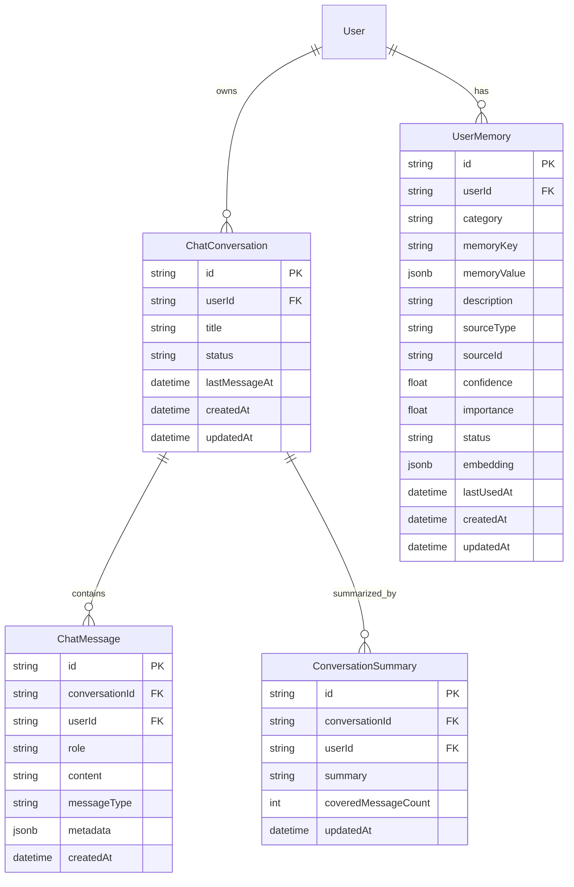
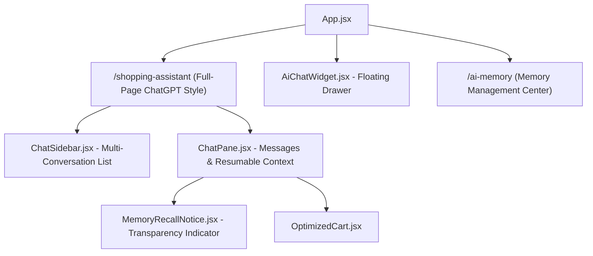
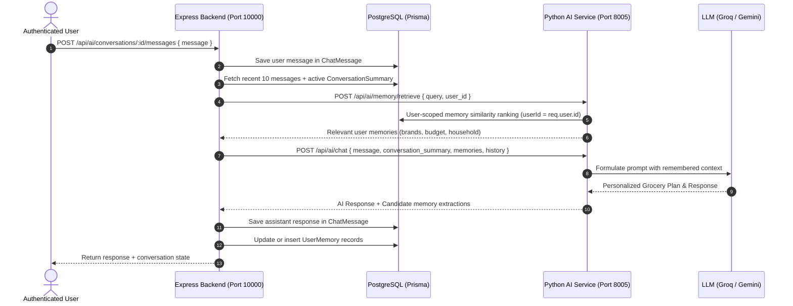

# ShopPilot – Persistent AI Chat History, Resumable Conversations & User-Specific Semantic Long-Term Memory
## Architecture Audit & Implementation Plan

> **Deliverable for Phase 1 (Audit)**  
> Prepared for PayPal AI Hackathon — ShopPilot Project

---

## 1. Existing Architecture Findings

### 1.1 Existing Chat Architectures in FreshCart
The inspection of the codebase reveals two distinct chat systems currently present in the repository:
1. **Human Customer-to-Seller Live Support (`UserChat.jsx` / `server/sockets/chatSocket.js`)**:
   - Built on Socket.IO and the existing Prisma `Message` model (`id`, `senderId`, `message`, `fromSeller`, `isUnreadForSeller`, `createdAt`).
   - Handles real-time messaging between human buyers and store sellers.
   - Mounted as a floating drawer icon on the bottom right (`UserChat.jsx`).
2. **AI Shopping Assistant (`ShoppingAssistant.jsx` & `AiChatWidget.jsx`)**:
   - Connected via `server/routes/aiProxyRoutes.js` (`POST /api/ai/chat`) to the Python FastAPI microservice on port 8005.
   - Uses an ephemeral `conversation_id` generated via `sessionStorage.getItem("shoppilot_ai_cid")` or randomly on each session.
   - **Current State Limitations**:
     - **No Database Persistence**: Neither conversations nor messages are stored in PostgreSQL.
     - **Transient Memory**: Memory is only preserved in-memory within Python's `MemorySaver()` checkpointer during a single active process runtime.
     - **Refresh Loss**: Refreshing the browser or opening a new tab generates a new session ID and wipes out the chat transcript.
     - **No Login Gating**: Guest users can trigger the AI assistant, polluting conversation state with unauthenticated sessions (`sess_guest_...`).
     - **Zero Long-Term Memory**: The assistant has no mechanism to recall household size, favorite brands, typical budgets, or past order patterns across different conversations.

### 1.2 Current Authentication Flow
- **Token Management**: JWT tokens stored in `localStorage.getItem("token")`.
- **Backend Middleware**:
  - `server/middlewares/authUser.js`: Validates `Authorization: Bearer <token>`, decodes user ID, and injects `req.user` from PostgreSQL.
  - `server/middlewares/optionalAuth.js`: Attempts to decode JWT if present, otherwise leaves `req.user` null.
- **Frontend State**: `AppContext.jsx` maintains `user` state fetched on mount via `GET /api/userAuth/profile`. When logged out, `user === false`.
- **Finding**: Currently, `POST /api/ai/chat` uses `optionalAuth`. To satisfy Phase 4, conversation creation and retrieval must strictly enforce `authUser`.

### 1.3 Database Structure & Relationships
- **Database Engine**: PostgreSQL 18.6 on port 5432 with Prisma ORM 6.4.1.
- **User Model**:
  - `User` (`id`, `name`, `email`, `password`, `createdAt`, `updatedAt`).
  - Relations: `orders Order[]`, `messages Message[]`, `carts Cart[]`.
- **Order Model**:
  - `Order` (`id`, `userId`, `shippingAddress`, `paymentMethod`, `totalAmount`, `status`, `paymentStatus`, `paypalOrderId`, `paypalCaptureId`).
  - `OrderItem` (`id`, `orderId`, `productId`, `quantity`, `productName`, `unitPrice`, `packageSize`, `subtotal`).
- **Vector Capability Audit**:
  - PostgreSQL query `SELECT * FROM pg_available_extensions WHERE name = 'vector';` returned `[]` on this Windows host.
  - **Decision**: Embeddings will be stored as high-precision `Float[]` (or JSONB vector arrays) in PostgreSQL. Vector cosine similarity ranking will be handled natively via optimized SQL / Python dot-product distance calculation. This guarantees 100% platform portability across Windows, Linux, and Docker environments without failing Prisma schema migrations.

---

## 2. Proposed Database Schema (`server/prisma/schema.prisma`)

We will add 4 new entities to Prisma, maintaining foreign keys, cascade deletion, and indexing:



### 2.1 Prisma Model Definitions

```prisma
model ChatConversation {
  id            String                @id @default(uuid())
  userId        String                @map("user_id")
  user          User                  @relation(fields: [userId], references: [id], onDelete: Cascade)
  title         String                @default("New Grocery Plan")
  status        String                @default("active") // "active", "archived"
  lastMessageAt DateTime              @default(now()) @map("last_message_at")
  createdAt     DateTime              @default(now()) @map("created_at")
  updatedAt     DateTime              @updatedAt @map("updated_at")

  messages      ChatMessage[]
  summaries     ConversationSummary[]

  @@index([userId, status])
  @@index([userId, lastMessageAt(sort: Desc)])
  @@map("chat_conversations")
}

model ChatMessage {
  id             String           @id @default(uuid())
  conversationId String           @map("conversation_id")
  conversation   ChatConversation @relation(fields: [conversationId], references: [id], onDelete: Cascade)
  userId         String           @map("user_id")
  user           User             @relation(fields: [userId], references: [id], onDelete: Cascade)
  role           String           // "user", "assistant", "system", "tool"
  content        String
  messageType    String           @default("text") @map("message_type") // "text", "plan", "clarification"
  metadata       Json?            // Stores grocery_plan, matched_products, optimized_cart breakdown
  createdAt      DateTime         @default(now()) @map("created_at")
  updatedAt      DateTime         @updatedAt @map("updated_at")

  @@index([conversationId, createdAt(sort: Asc)])
  @@index([userId])
  @@map("chat_messages")
}

model ConversationSummary {
  id                  String           @id @default(uuid())
  conversationId      String           @map("conversation_id")
  conversation        ChatConversation @relation(fields: [conversationId], references: [id], onDelete: Cascade)
  userId              String           @map("user_id")
  user                User             @relation(fields: [userId], references: [id], onDelete: Cascade)
  summary             String
  coveredMessageCount Int              @default(0) @map("covered_message_count")
  version             Int              @default(1)
  createdAt           DateTime         @default(now()) @map("created_at")
  updatedAt           DateTime         @updatedAt @map("updated_at")

  @@index([conversationId])
  @@map("conversation_summaries")
}

model UserMemory {
  id           String    @id @default(uuid())
  userId       String    @map("user_id")
  user         User      @relation(fields: [userId], references: [id], onDelete: Cascade)
  category     String    // "shopping_preference", "household_context", "brand_preference", "budget_preference", "dietary_preference"
  memoryKey    String    @map("memory_key") // e.g. "preferred_milk_brand", "household_size", "weekly_budget"
  memoryValue  Json      @map("memory_value") // Structured value e.g. "Amul", 4, {"amount": 2500, "period": "weekly"}
  description  String    // Human-readable explanation: "User prefers Amul for dairy products"
  sourceType   String    @map("source_type") // "conversation", "order_history", "user_confirmed"
  sourceId     String?   @map("source_id") // ID of conversation or order
  confidence   Float     @default(1.0)
  importance   Float     @default(0.8)
  status       String    @default("active") // "active", "superseded", "deleted"
  embedding    Json?     // Vector embedding array (e.g. 384 or 768 floats)
  lastUsedAt   DateTime? @map("last_used_at")
  createdAt    DateTime  @default(now()) @map("created_at")
  updatedAt    DateTime  @updatedAt @map("updated_at")

  @@unique([userId, memoryKey, status])
  @@index([userId, status, category])
  @@map("user_memories")
}

model UserMemorySetting {
  id               String   @id @default(uuid())
  userId           String   @unique @map("user_id")
  user             User     @relation(fields: [userId], references: [id], onDelete: Cascade)
  autoExtract      Boolean  @default(true) @map("auto_extract")
  includeInContext Boolean  @default(true) @map("include_in_context")
  createdAt        DateTime @default(now()) @map("created_at")
  updatedAt        DateTime @updatedAt @map("updated_at")

  @@map("user_memory_settings")
}
```

---

## 3. Proposed API Endpoints

All endpoints will be mounted on the Express backend (`server/`) and protected with `authUser`:

### 3.1 Conversation Management (`/api/ai/conversations`)
| Method | Endpoint | Description |
|---|---|---|
| `POST` | `/api/ai/conversations` | Create a new conversation for authenticated user. |
| `GET` | `/api/ai/conversations` | List user's conversations (paginated, sorted by `lastMessageAt DESC`). |
| `GET` | `/api/ai/conversations/:id` | Get single conversation details and active summary. |
| `PATCH` | `/api/ai/conversations/:id` | Rename title or change status (active/archived). |
| `DELETE` | `/api/ai/conversations/:id` | Permanently delete conversation and its messages. |

### 3.2 Messages & Resumable Chat (`/api/ai/conversations/:id/messages`)
| Method | Endpoint | Description |
|---|---|---|
| `GET` | `/api/ai/conversations/:id/messages` | Fetch messages for a conversation (chronological pagination). |
| `POST` | `/api/ai/conversations/:id/messages` | User sends message; loads context + memory; invokes AI; saves user and assistant messages atomically. |

### 3.3 Long-Term Memory APIs (`/api/ai/memories`)
| Method | Endpoint | Description |
|---|---|---|
| `GET` | `/api/ai/memories` | List all active memories for the authenticated user, grouped by category. |
| `POST` | `/api/ai/memories` | Manually add or confirm a memory preference. |
| `PATCH` | `/api/ai/memories/:id` | Edit an existing memory value/description. |
| `DELETE` | `/api/ai/memories/:id` | Delete/invalidate a memory. |
| `POST` | `/api/ai/memories/sync-orders` | Analyze user's paid order history and extract verified behavioral observations. |
| `GET` | `/api/ai/memories/settings` | Get user memory settings (`autoExtract`, `includeInContext`). |
| `PATCH` | `/api/ai/memories/settings` | Toggle automatic extraction or memory injection. |

---

## 4. Frontend Component Changes



### 4.1 Upgraded Multi-Conversation Interface (`ShoppingAssistant.jsx`)
- **ChatGPT-Style Layout**:
  - **Left Sidebar**:
    - **"New Chat"** button (creates new PostgreSQL conversation).
    - **Search Box** (real-time filtering of user conversations).
    - **Conversation List**: Shows titles, timestamps, active selection, and three-dots menu (Rename, Archive, Delete).
    - **Settings / Memory Pill**: Link to "My AI Memory" dashboard.
  - **Right Main Chat View**:
    - Header showing conversation title (editable inline).
    - Full chronological message stream with clean user/assistant speech bubbles.
    - **Personalization Badge**: When an assistant recommendation leverages stored memory (e.g., *"Applied your preference for Amul dairy and ₹2,500 budget"*), an interactive tag highlights the remembered fact with an edit/feedback shortcut.
    - Chat input with auto-expanding textarea, send button, and loading spinner.

### 4.2 Dedicated Memory Management UI (`MyAiMemory.jsx`)
- Accessible via `/ai-memory` and from the user profile / assistant header.
- Displays organized memory cards categorized into:
  - 🏠 **Household & Duration** (e.g. 4 people, 7-day cycles)
  - 💰 **Budget Preferences** (e.g. ₹2,500 weekly, affordable options)
  - 🏷️ **Brand Preferences** (e.g. Amul, Aashirvaad, Tata Sampann)
  - 🥗 **Dietary Context** (e.g. Vegetarian)
  - 📊 **Order History Patterns** (e.g. "Fresh Milk appeared in 6 of your last 7 orders")
- Actions on each memory card:
  - **Edit** modal to correct values.
  - **Delete / Forget** button with confirmation.
  - **Privacy Toggle**: "Enable/Disable automatic memory extraction".

### 4.3 Mandatory Authentication Gate
- Both [`ShoppingAssistant.jsx`](file:///d:/FreshCart/client/src/components/ai/ShoppingAssistant.jsx) and [`AiChatWidget.jsx`](file:///d:/FreshCart/client/src/components/ai/AiChatWidget.jsx) check `user` from `AppContext`:
  - If `!user`, render an inviting preview banner: *"Please log in to access your personalized ShopPilot assistant, save conversations, and customize shopping preferences."* with a **"Log In / Sign Up"** button that opens `Login.jsx`.
  - Upon successful login, the user is seamlessly returned to their conversations.

---

## 5. Memory Extraction & Semantic Retrieval Architecture



### 5.1 Extraction Pipeline (Post-Response Asynchronous Task)
1. **Conversation Extraction Node**:
   - Analyzes recent user utterances for explicit preferences (e.g., *"I want Amul milk"*, *"Our family has 4 members"*, *"My weekly limit is ₹3,000"*).
   - Validated against a strict Pydantic model (`ExtractedMemorySet`).
   - Rejects temporary one-off requests (e.g., *"I only have ₹500 today"* is flagged as a session constraint, not a permanent preference).
2. **Order History Mining**:
   - `GET /api/ai/memories/sync-orders` queries user's `PAID` orders from PostgreSQL.
   - Calculates frequency metrics (e.g., product frequency $\ge 3$ orders or category concentration $\ge 40\%$).
   - Flags source as `sourceType: "order_history"`.
3. **Conflict Resolution & Superseding**:
   - Before insertion, checks for existing memories with matching `(userId, memoryKey)`.
   - If a new contradictory statement is detected (e.g. user says *"Switch my milk preference from Amul to Mother Dairy"*), the older record is marked `status: "superseded"` and the new preference is marked `active`.

### 5.2 Lightweight Semantic Embeddings & User-Isolated Retrieval
- **Embedding Provider**: Built into Python microservice using `fastembed` (all-MiniLM-L6-v2, 384-dimensional, runs in-memory with zero cloud costs and <5ms inference) or Gemini embeddings.
- **Strict User Scoping**:
  $$\text{Query: } \text{WHERE user\_id} = \$1 \text{ AND status} = \text{'active'}$$
  Cross-user queries are mathematically impossible at the database query level.
- **Composite Relevance Score**:
  $$\text{Score} = 0.60 \times \text{CosineSimilarity} + 0.25 \times \text{Importance} + 0.15 \times \text{Recency}$$
- Only top-k ($k=5$) memories above similarity threshold ($0.65$) are injected into the prompt.

---

## 6. Security & Privacy Considerations

1. **Strict User Ownership Verification**:
   - Every conversation, message, and memory operation checks:
     ```js
     const conversation = await prisma.chatConversation.findFirst({
       where: { id: req.params.id, userId: req.user.id },
     });
     if (!conversation) return res.status(404).json({ success: false, message: "Conversation not found" });
     ```
2. **No Data Leakage**:
   - Vector search and memory lookups are hard-coded to filter by `req.user.id`.
   - Prompt sanitization prevents prompt injections from memory text.
3. **Sensitive Attribute Protection**:
   - System prompts explicitly prohibit inferring medical conditions, religion, race, or health conditions. Only explicit grocery/budget preferences are preserved.
4. **GDPR / Right-to-be-Forgotten**:
   - "Clear All Memory" permanently deletes all vector and text records from PostgreSQL.
   - Deleting a conversation deletes all associated messages and summaries via foreign key cascade.

---

## 7. Phased Implementation Plan

| Phase | Tasks | Key Deliverables |
|---|---|---|
| **Phase 2: Database** | Extend `schema.prisma` with `ChatConversation`, `ChatMessage`, `ConversationSummary`, `UserMemory`, `UserMemorySetting`. Run `prisma db push` & `generate`. | Database synced with 5 new models. |
| **Phase 3 & 4: Backend APIs** | Implement `conversationController.js`, `memoryController.js`, and express routes under `/api/ai/`. Enforce `authUser` on all endpoints. | Verified REST APIs with user ownership checks. |
| **Phase 5 & 6: AI Memory Engine** | Implement memory extraction prompt, `fastembed` embedding generation, user-isolated retrieval service, and order history miner in `ai-service/`. | User preferences remembered & surfaced in LangGraph. |
| **Phase 7: Context & Summaries**| Automatic conversation summary generator when messages exceed 15; inject summary + top-5 memories into grocery planning. | Long-running conversations remain fast & token-efficient. |
| **Phase 8 & 9: Frontend UI** | Build ChatGPT-style multi-chat sidebar, conversation switching, rename/delete modals, and `MyAiMemory.jsx` management dashboard. | Full user experience with persistent history and memory control. |
| **Phase 10: Verification** | Build comprehensive automated test suite `server/test/chatMemoryVerify.js` testing user isolation, history resumption, memory extraction, and conflict resolution. | 100% test pass rate across all acceptance criteria. |
| **Phase 11: Docs & Commit** | Author `docs/SHOPPILOT_CHAT_MEMORY_ARCHITECTURE.md`, update `README.md`, and commit to Git. | Complete documentation and clean repository state. |

---

*Please review this audit and implementation plan. Once approved, implementation will proceed starting with Phase 2 (Database Schema).*

