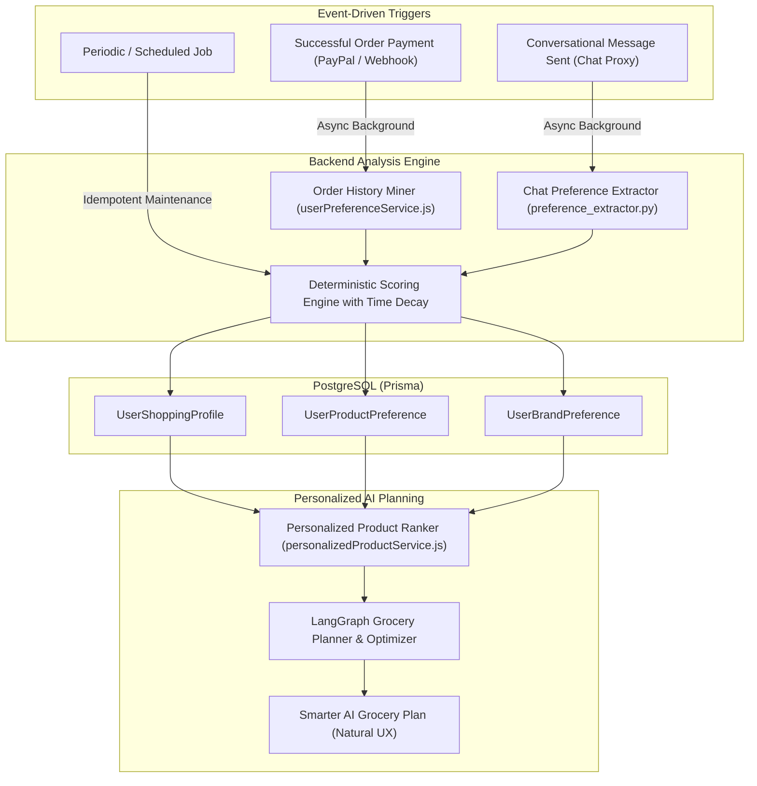

# ShopPilot: Invisible User Preference Learning & Personalized AI Grocery Recommendations
## Phase 1 — Comprehensive Architecture Audit & Proposed Implementation Plan

---

### 1. Executive Summary & Objective

The objective is to implement an **invisible, background personalization and preference-learning engine** for ShopPilot. 

#### Core Principle: Zero Visible Memory UI
As explicitly specified by the customer:
> *"I do NOT want to display AI memory, saved preferences, embeddings, extracted user profiles or memory management interfaces to customers. The system must work silently in the backend... The customer should simply experience a smarter AI shopping assistant."*

The system will silently:
1. Mine eligible **completed and paid order history** for recurring staple products, brand loyalty, category distributions, and spending bands.
2. Extract **explicit user statements** from conversational dialogue (e.g., *"I prefer Amul milk"*, *"I don't like mushrooms"*, *"Keep it budget-friendly"*).
3. Compute a **deterministic preference score** (0.0 to 1.0) with exponential time-decay for aging purchases and immediate overrides for explicit dislikes.
4. Seamlessly inject this profile into the LangGraph grocery planner and product ranking pipeline so that future recommendations naturally prioritize the user's favorite products and brands—without exposing scores, memory pills, or technical jargon.

---

### 2. Audit of Existing Repository Architecture

#### 2.1 Backend Models (Prisma ORM & PostgreSQL)
Inspected in [`server/prisma/schema.prisma`](file:///d:/FreshCart/server/prisma/schema.prisma):
- **`User`**: Core authenticated user model (`id` UUID, `name`, `email`, `password`).
- **`Product`**: Catalog item model (`id` UUID, `name`, `brand` String?, `category` String, `price` Float, `offerPrice` Float, `inStock` Boolean, `stockQuantity` Int, `description` String[], `image` String[]).
- **`Order`**: Order header (`id` UUID, `userId` FK, `totalAmount` Float, `currency` String, `status` String, `paymentStatus` String, `shippingAddress` String).
- **`OrderItem`**: Line items (`id` UUID, `orderId` FK, `productId` FK, `quantity` Int, `unitPrice` Float?, `subtotal` Float?).
- **`ChatConversation` & `ChatMessage`**: PostgreSQL persistent chat system (`userId` FK, `role`, `content`, `metadata` JSONB).
- **`UserMemory` & `UserMemorySetting`**: Previously implemented memory records.

#### 2.2 Payment & Order Lifecycle
- Successfully paid orders are designated by `paymentStatus === "Paid"` (handled via PayPal Controller in [`server/controllers/paypalController.js`](file:///d:/FreshCart/server/controllers/paypalController.js) and Webhooks in [`server/services/paypal/paypalWebhookService.js`](file:///d:/FreshCart/server/services/paypal/paypalWebhookService.js)).
- Orders with `paymentStatus: "Pending"`, `"Failed"`, or `"Cancelled"` exist and **must be strictly excluded** from purchase preference learning.

#### 2.3 AI Microservice & Discovery
- **FastAPI / LangGraph (Port 8005)**:
  - [`ai-service/app/agents/nodes/intent_extractor.py`](file:///d:/FreshCart/ai-service/app/agents/nodes/intent_extractor.py): Extracts family size, duration, budget, and dietary restrictions.
  - [`ai-service/app/discovery/product_scorer.py`](file:///d:/FreshCart/ai-service/app/discovery/product_scorer.py): Multi-factor product candidate scoring (`0.35 * semantic + 0.20 * category + 0.15 * package_suitability + 0.10 * brand + 0.10 * price + 0.10 * stock`).
  - [`ai-service/app/discovery/product_discovery.py`](file:///d:/FreshCart/ai-service/app/discovery/product_discovery.py): Catalog search & filtering against PostgreSQL.
  - [`ai-service/app/optimization/optimizer.py`](file:///d:/FreshCart/ai-service/app/optimization/optimizer.py): Budget optimization and package size selection.

#### 2.4 Frontend Analysis & Cleanup Needed
- [`client/src/components/ai/ShoppingAssistant.jsx`](file:///d:/FreshCart/client/src/components/ai/ShoppingAssistant.jsx): Contains chat sidebar, conversation manager, and currently contains links to `/ai-memory` and "Remembered" memory tags.
- [`client/src/components/Navbar.jsx`](file:///d:/FreshCart/client/src/components/Navbar.jsx) and [`client/src/App.jsx`](file:///d:/FreshCart/client/src/App.jsx): Include links to `/ai-memory`.
- **Action Required**: Remove visible "My AI Memory" page, memory badges, counters, and navigation links. Convert the experience into a seamless, natural dialogue where the assistant simply suggests the user's favored products without exposing memory infrastructure.

---

### 3. Proposed Database Schema Design

We will add three normalized, high-performance tables in PostgreSQL via Prisma:

```mermaid
erDiagram
    User ||--o| UserShoppingProfile : "has 1:1"
    User ||--o{ UserProductPreference : "has 1:N"
    User ||--o{ UserBrandPreference : "has 1:N"
    Product ||--o{ UserProductPreference : "referenced by"

    UserShoppingProfile {
        uuid id PK
        uuid userId FK,UQ
        jsonb preferredCategories
        jsonb preferredBrands
        jsonb frequentlyPurchasedProducts
        string pricePreference
        float typicalBudget
        string budgetCurrency
        int typicalShoppingInterval
        int householdSize
        datetime lastAnalyzedAt
        datetime createdAt
        datetime updatedAt
    }

    UserProductPreference {
        uuid id PK
        uuid userId FK
        uuid productId FK
        int purchaseCount
        int totalQuantityPurchased
        datetime lastPurchasedAt
        datetime firstPurchasedAt
        float averagePurchaseInterval
        float preferenceScore
        boolean explicitlyPreferred
        boolean isDisliked
        datetime updatedAt
    }

    UserBrandPreference {
        uuid id PK
        uuid userId FK
        string brand
        int purchaseCount
        datetime lastPurchasedAt
        float preferenceScore
        boolean isDisliked
        datetime updatedAt
    }
```

#### 3.1 `UserShoppingProfile` (1:1 with User)
Stores high-level aggregated shopping persona:
- `id`: UUID Primary Key.
- `userId`: Foreign key to `User`, unique constraint.
- `preferredCategories`: JSONB array of `{ category: string, frequency: number, weight: number }`.
- `preferredBrands`: JSONB array of `{ brand: string, affinityScore: number, source: string }`.
- `frequentlyPurchasedProducts`: JSONB array of top staple product IDs and names.
- `pricePreference`: Enum/String (`"budget_friendly"`, `"balanced"`, `"premium"`). Derived from comparison of user's average chosen unit price vs category medians.
- `typicalBudget`: Float. Average spend per order.
- `budgetCurrency`: String (`"INR"`).
- `typicalShoppingInterval`: Integer (average days between repeat orders).
- `householdSize`: Integer (nullable; populated only when explicitly stated in chat).
- `lastAnalyzedAt`: DateTime. Timestamp of last background batch calculation.
- `createdAt` & `updatedAt`: DateTime.

#### 3.2 `UserProductPreference` (1:N per User, unique on `[userId, productId]`)
Granular behavioral and explicit product tracking:
- `id`: UUID Primary Key.
- `userId`: Foreign key to `User`.
- `productId`: Foreign key to `Product`.
- `purchaseCount`: Total number of orders containing this item.
- `totalQuantityPurchased`: Total units purchased.
- `lastPurchasedAt`: Date of most recent purchase.
- `firstPurchasedAt`: Date of earliest purchase.
- `averagePurchaseInterval`: Average days between repeat orders.
- `preferenceScore`: Float (0.0 to 1.0). Deterministic composite score.
- `explicitlyPreferred`: Boolean (set when user explicitly praises/demands the item in chat).
- `isDisliked`: Boolean (set when user explicitly rejects or dislikes the item).
- **Constraints**: `@@unique([userId, productId])`, `@@index([userId, preferenceScore(sort: Desc)])`.

#### 3.3 `UserBrandPreference` (1:N per User, unique on `[userId, brand]`)
- `id`: UUID Primary Key.
- `userId`: Foreign key to `User`.
- `brand`: Cleaned brand string (e.g., `"Amul"`, `"Fortune"`).
- `purchaseCount`: Total times brand was ordered.
- `lastPurchasedAt`: Date of most recent brand purchase.
- `preferenceScore`: Float (0.0 to 1.0).
- `isDisliked`: Boolean (immediate boycott flag).
- **Constraints**: `@@unique([userId, brand])`, `@@index([userId, preferenceScore(sort: Desc)])`.

---

### 4. Preference Learning Architecture



#### 4.1 Order History Mining (`userPreferenceService.js`)
- **Query Filter**: Strictly queries orders where `userId === req.user.id` AND `paymentStatus === "Paid"`. Excludes `"Cancelled"`, `"Failed"`, and `"Pending"`.
- **Product Stats**: Calculates `purchaseCount`, `totalQuantityPurchased`, and interval between order dates.
- **Brand & Category Aggregation**: Extracts brand and category from each `orderItem.product` and computes distribution shares.
- **Price Sensitivity**: Computes median order value and classifies user into `"budget_friendly"`, `"balanced"`, or `"premium"`.

#### 4.2 Conversational Preference Extraction (`preference_extractor.py`)
- Analyzes customer messages for explicit signals:
  - Preferred brand: *"I prefer Amul milk"*, *"We only use Fortune oil"*.
  - Disliked item: *"I don't like mushrooms"*, *"Stop suggesting Nestlé"*.
  - Dietary context: *"Pure veg only"*, *"We are a family of 5"*.
  - Budget preference: *"Always find the cheapest option"*.
- Strict rule: **Never infer preferences from assistant suggestions**, only from user turns.
- Contradiction resolution: A newer explicit user statement immediately supersedes older conflicting entries.

---

### 5. Deterministic Preference Scoring Algorithm

Instead of arbitrary LLM hallucinations, preference scores are calculated using a strict, testable mathematical formula:

$$\text{Score} = w_f \cdot S_{\text{freq}} + w_r \cdot S_{\text{recency}} + w_e \cdot S_{\text{explicit}} + w_s \cdot S_{\text{repeat}}$$

Where:
- $w_f = 0.35$ (Purchase Frequency Weight)
- $w_r = 0.30$ (Recency Weight with exponential decay)
- $w_e = 0.20$ (Explicit Preference Statement Weight)
- $w_s = 0.15$ (Repeat Selection / Substitution Acceptance Weight)

#### Exponential Time Decay:
$$S_{\text{recency}} = \exp\left(-\frac{\ln(2)}{t_{\text{half}}} \cdot \Delta t\right)$$
- $\Delta t$ = Days elapsed since last purchase.
- $t_{\text{half}} = 45\text{ days}$ (Purchases older than 45 days retain half weight; purchases older than 90 days retain 25% weight).

#### Negative Preference Guard:
$$\text{If } \text{isDisliked} = \text{true} \implies \text{Score} = 0.0 \quad (\text{Strict exclusion from recommendations})$$

---

### 6. Personalized Product Ranking Service

When the AI Shopping Concierge selects candidate products to fulfill a grocery item requirement (e.g., "Milk" for a 7-day grocery plan), products are ranked via:

$$\text{Final Ranking Score} = 0.35 \cdot \text{Relevance} + 0.20 \cdot \text{Availability} + 0.15 \cdot \text{PriceSuitability} + 0.15 \cdot \text{BrandScore} + 0.15 \cdot \text{ProductPreferenceScore}$$

#### Mandatory Ranking Invariants:
1. **Out of Stock Rule**: Any product with `inStock === false` or `stockQuantity < 1` receives an availability score of `0.0` and is never selected as purchasable.
2. **Current Price Rule**: Live PostgreSQL catalog `offerPrice` is always authoritative. Historical order prices are never reused.
3. **Instruction Priority Rule**: Immediate user requests (e.g., *"Suggest a cheaper milk brand this week"*) explicitly override stored brand loyalty.

---

### 7. Natural, Invisible User Experience

In accordance with user instructions:
- **No Memory Dashboard**: Remove `/ai-memory` and any memory management buttons or tabs.
- **Natural Conversational Phrasing**:
  - Instead of: *"Found 3 memories in vector index: category Dairy, brand Amul"*
  - The assistant says: *"I've put together your weekly plan, prioritizing Amul milk and fresh staples based on your usual shopping choices."*
- **Seamless Adaptability**: The user simply notices the assistant recommending their preferred brands and quantities without needing to configure settings.

---

### 8. Phased Implementation Plan

| Phase | Description | Deliverables |
| :--- | :--- | :--- |
| **Phase 1 (Current)** | Repository audit, schema design, and approval. | `SHOPPILOT_PREFERENCE_LEARNING_AUDIT.md` |
| **Phase 2** | Database schema additions via Prisma without DB reset. | `UserShoppingProfile`, `UserProductPreference`, `UserBrandPreference` in `schema.prisma`. |
| **Phase 3** | Order History Miner & Unit Tests. | `server/services/userPreferenceService.js` (mines paid orders only). |
| **Phase 4** | Conversational Preference Extractor. | `ai-service/app/services/preference_extractor.py` (Pydantic schema, explicit signal parser). |
| **Phase 5** | Deterministic Preference Scoring with Recency Decay. | `server/services/preferenceScoringService.js` + test suite. |
| **Phase 6** | Background Idempotent Triggers. | Post-payment hook in `paypalController.js` and async post-chat hook in `aiConversationController.js`. |
| **Phase 7** | Personalized Product Ranker & LangGraph Integration. | `server/services/personalizedProductService.js` & `product_scorer.py` update. |
| **Phase 8** | Frontend Invisible Clean-Up. | Remove visible memory page, badges, and headers from `ShoppingAssistant.jsx` and `Navbar.jsx`. |
| **Phase 9** | End-to-End Verification & Architecture Documentation. | `server/test/preferenceLearningVerify.js` & `docs/SHOPPILOT_PERSONALIZATION_ARCHITECTURE.md`. |

---

### 9. Awaiting User Approval

Per instructions, **no source code has been altered yet**. Please review this audit report, proposed database schema, scoring model, and phased roadmap. Once you approve, I will proceed to Phase 2.

