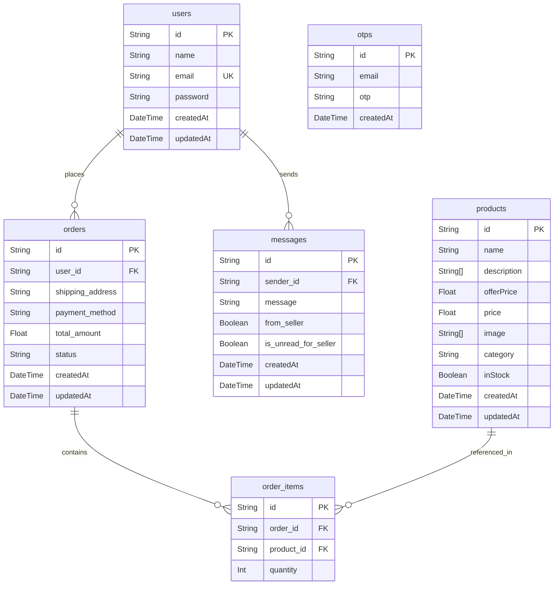

# 🛒 ShopPilot — Step 1 Architecture & Code Audit Report
**Project:** FreshCart → ShopPilot (AI-Powered Autonomous Grocery Shopping Agent)  
**Date:** November 2026  
**Auditor:** Senior Full-Stack Engineer & Software Architect  

---

## 1. Executive Summary

This audit assesses the existing **FreshCart** grocery ecommerce codebase at `D:\FreshCart` prior to executing Step 1 of evolving it into **ShopPilot**. FreshCart is a working full-stack React + Express + Prisma/PostgreSQL grocery platform with an authenticated customer store, a seller dashboard, real-time customer chat, and third-party payment gateways (Razorpay, Stripe).

The catalog currently holds **231 authentic Indian grocery products** categorized across 8 standard grocery departments:
- **Snacks & Chocolates:** 61 items
- **Grains & Flours:** 27 items
- **Drinks & Beverages:** 25 items
- **Fruits:** 25 items
- **Vegetables:** 25 items
- **Instant Foods:** 24 items
- **Dairy Products:** 22 items
- **Bakery & Breads:** 22 items

---

## 2. Core Audit Findings & Answers to Specific Questions

### Q1: Which database is actively used at runtime?
- **Active Runtime Database:** **PostgreSQL via Prisma ORM 6.4**.
- In `server/config/db.js`, `prisma.$connect()` establishes connection to PostgreSQL.
- In `server/server.js`, `connectDB()` is called at startup.
- All primary operational controllers (`productController.js`, `sellerProductController.js`, `orderController.js`, `userController.js`) import `prisma` from `server/config/prisma.js` and interact exclusively with PostgreSQL tables: `users`, `products`, `orders`, `order_items`, `messages`, `otps`.
- **Legacy Mongoose files:** `server/models/` contains legacy Mongoose schemas (`user.js`, `orders.js`, `Product.js`, etc.) from an earlier MongoDB version. They are **not** imported by any operational route or controller.

### Q2: Are all 231 products available through Prisma/PostgreSQL?
- **Yes.** Verification through `prisma.product.groupBy` shows exact product distribution:
  - Bakery: 22
  - Drinks: 25
  - Snacks: 61
  - Dairy: 22
  - Fruits: 25
  - Grains: 27
  - Instant: 24
  - Vegetables: 25
  - **Total: 231 products**
- All 231 products are backed by high-resolution images, dual Hindi/English names where applicable, MRP, offer price, and bullet-point descriptions.
- `server/prisma/seed.js` is fully synchronized with this catalog.

### Q3: How does the frontend currently retrieve products?
- On application startup, `client/src/context/AppContext.jsx` executes:
  `axios.get('${API_URL}/products')`
- The backend responds with `{ products: [...] }` containing all database records.
- The product array is kept in React Context (`products`).
- Pages (`AllProducts.jsx`, `ProductCategory.jsx`) perform client-side filtering (by category and `searchQuery`) and paginate client-side using a batch window (24 items at a time with "Load More").
- `ProductDetails.jsx` retrieves individual items via `GET /api/products/:id`.

### Q4: How does the current cart work?
- `AppContext.jsx` exposes:
  - `addToCart(productId)`
  - `removeFromCart(productId)`
  - `updateQuantity(productId, newQty)`
  - `getCartQuantityById(productId)`
- When an item is added, its `_id`, `name`, `price` (which is `offerPrice`), `image`, and `quantity` (initial 1) are appended to `cartItems`.

### Q5: Where is the cart stored?
- Cart state is currently stored **only on the client side in `localStorage`** (`cartItems`).
- There is **no persistent cart table or cart endpoint on the backend**.
- While simple for guest browsing, this means:
  - The backend is not the authority on pricing, inventory, or cart state.
  - An autonomous AI agent cannot query or modify a user's cart without browser simulation unless backend cart services are introduced.

### Q6: How are product prices calculated?
- **In Frontend Cart:** Subtotal is calculated via `cartItems.reduce((sum, item) => sum + item.price * item.quantity, 0)`. GST is calculated as `Math.round(totalPrice * 0.05)`.
- **In Backend Order Creation (`createOrder`):** The backend recalculates `subtotal` by looking up each product's `offerPrice` from PostgreSQL using `prisma.product.findUnique`. GST is added as 5%. The client-supplied prices are safely disregarded when writing to the `orders` table.

### Q7: How is inventory updated?
- The current `Product` schema has a boolean `inStock` flag (`Boolean @default(true)`), but **no numeric `stockQuantity` integer column**.
- When an order is placed (`createOrder` in `orderController.js`), `orderItems` are created, but stock is not decremented numerically because only `inStock` boolean exists.
- In `sellerProductController.js`, sellers can toggle `inStock: true/false`.

### Q8: How do seller product management operations work?
- Protected via `authSeller` middleware verifying that the JWT email matches `process.env.SELLER_EMAIL`.
- `POST /api/seller/add-product`: Receives multipart form data with images via `multer` (memory buffer), uploads to Cloudinary in the `products` folder, parses description, and creates a PostgreSQL product record.
- `GET /api/seller/products`: Returns all products.
- `PUT /api/seller/update/:id`: Updates `offerPrice` and `inStock`.
- `DELETE /api/products/:id`: Deletes a product from PostgreSQL.

### Q9: Are there duplicate or conflicting APIs?
- `getAllProducts` vs `getAllProductsForSeller`: Both query `prisma.product.findMany({ orderBy: { createdAt: "desc" } })`.
- Product add/update routes exist in both `productRoutes.js` and `sellerRoutes.js` (`/api/products/add` vs `/api/seller/add-product`, `/api/products/update` vs `/api/seller/update/:id`). These should be standardized in Step 1 while retaining backward compatibility.
- Route prefixes: `/api/userAuth` handles login/registration, while `/api/users` also mounts `userRoutes.js`.

### Q10: Are any important features incomplete?
- **Server-side Cart System:** Missing backend cart persistence and cart session API.
- **Product Inventory Units & Stock Count:** Products have `inStock` (boolean) but lack `stockQuantity` (integer) and `unit` (e.g., "1 kg", "500g", "1L").
- **Backend Search, Pagination & Filtering:** `GET /api/products` currently dumps all products without server-side `query`, `category`, `minPrice`, `maxPrice`, `sortBy`, or pagination parameters.
- **Categories Endpoint:** Categories are hardcoded strings without a dedicated `/api/categories` discovery endpoint.

---

## 3. Database Relationships (Prisma / PostgreSQL)

---

## 4. Existing API Endpoints Table

| Method | Endpoint | Controller Handler | Auth Required | Purpose |
|---|---|---|---|---|
| `GET` | `/api/products` | `getAllProducts` | None | Get all products |
| `GET` | `/api/products/bestsellers` | `getBestSellers` | None | Get top 4 ordered products |
| `GET` | `/api/products/:id` | `getProductById` | None | Get product detail |
| `POST` | `/api/products/add` | `createProduct` | Seller | Add product with images |
| `DELETE` | `/api/products/:id` | `deleteProduct` | Seller | Delete product |
| `POST` | `/api/seller/login` | `loginSeller` | None | Seller login |
| `GET` | `/api/seller/check-auth` | `checkSellerAuth` | Seller | Verify seller token |
| `POST` | `/api/seller/add-product` | `addProductWithImages` | None* (Needs auth guard check) | Add product |
| `GET` | `/api/seller/products` | `getAllProductsForSeller`| None* | Get seller products |
| `PUT` | `/api/seller/update/:id` | `updateProductDetails` | None* | Update price/stock |
| `PUT` | `/api/seller/update-order-status/:id` | `updateOrderStatus` | Seller | Update order status |
| `POST` | `/api/userAuth/register` | `registerUser` | None | Register new user |
| `POST` | `/api/userAuth/login` | `loginUser` | None | Login user (JWT) |
| `GET` | `/api/userAuth/profile` | `getUserProfile` | User | Get current profile |
| `POST` | `/api/userAuth/reset-password` | `resetPassword` | None | Reset password |
| `POST` | `/api/orders` | `createOrder` | User | Create new order |
| `GET` | `/api/orders/my-orders` | `getMyOrders` | User | Get user's orders |
| `GET` | `/api/orders/seller` | `getAllOrdersForSeller` | Seller | Get all store orders |
| `POST` | `/api/payment/razorpay` | `createRazorpayOrder` | User | Initialize Razorpay |
| `POST` | `/api/payment/stripe` | `createStripePayment` | User | Initialize Stripe |
| `POST` | `/api/otp/send-otp` | `sendOtp` | None | Send email verification OTP |
| `POST` | `/api/otp/verify-otp` | `verifyOtp` | None | Verify email OTP |
| `POST` | `/api/subscribe` | `subscribeUser` | None | Email newsletter subscription |

---

## 5. Bugs, Gaps & Architectural Risks

1. **`window.location.reload()` antipattern:**
   `Navbar.jsx` forces `window.location.reload()` on navigation links (`Home`, `All Products`, `Cart`, `MyOrders`). This breaks SPA benefits and causes flashes of unstyled state.
2. **Missing Backend Cart & Price Authority:**
   If a user leaves an item in localStorage for weeks, price changes on the backend aren't reflected until order checkout. Furthermore, an AI agent cannot manipulate cart state via API.
3. **No Database Numeric Stock:**
   `Product` only tracks `inStock: Boolean`. Without `stockQuantity: Int`, multi-item cart validation and partial out-of-stock scenarios cannot be enforced.
4. **No Server-Side Search & Filter:**
   Client currently loads all 231 products into memory. As the catalog grows, server-side filtering (`/api/products?search=tea&category=Drinks&minPrice=50&maxPrice=200&page=1`) is required.
5. **No Soft Deletion:**
   If a seller deletes a product that is referenced in historical `order_items`, foreign key constraints or queries referencing that product might fail unless handled.
6. **Hardcoded Brand Identity ("Hitman Grocery"):**
   Navbar, Razorpay description, and logo reference "Hitman Grocery". Needs rebranding to **ShopPilot** as part of Step 1.

---

## 6. Features to Reuse vs Features to Improve

### Reusable As-Is:
- **Authentication:** JWT user and seller auth (`authUser`, `authSeller`) are robust and functional.
- **Order Pipeline:** Razorpay and Stripe controllers, order creation with server-side price calculation, and order tracking.
- **Image Pipeline:** Cloudinary upload and Unsplash CDN image integration.
- **Socket.IO:** Real-time customer-seller chat socket architecture.
- **Prisma Client Setup:** Extended client with computed `_id` field in `server/config/prisma.js` ensures smooth backward compatibility with React code.

### Needs Improvement (Step 1 Scope):
1. **Service Layer Separation:**
   Introduce `server/services/productService.js`, `cartService.js`, `inventoryService.js` to decouple business logic from Express `req/res`. This directly prepares the application for AI agent interaction.
2. **Server-Side Product Querying:**
   Enhance `GET /api/products` with query params: `search`, `category`, `minPrice`, `maxPrice`, `sortBy`, `inStockOnly`, `page`, `limit`.
3. **Categories API:**
   Add `GET /api/categories` and `GET /api/categories/:name/products`.
4. **Authoritative Cart API:**
   Add session/user-backed cart endpoints (`GET /api/cart`, `POST /api/cart/items`, `PUT /api/cart/items/:id`, `DELETE /api/cart/items/:id`, `DELETE /api/cart`) while retaining localStorage fallback for offline/guest browsing.
5. **Branding & UI Enhancements:**
   Rebrand navbar and headers to **ShopPilot**, add responsive price slider/filters, loading skeletons, and polished search experience.

---

## 7. Step 1 Implementation Roadmap

1. **Step 1.1 — Schema Refinement (Non-Destructive):**
   - Add optional `stockQuantity` (default 50), `unit`, `brand`, and `isActive` fields to `Product`.
   - Preserve all existing records and IDs.
2. **Step 1.2 — Service Architecture:**
   - Create `server/services/productService.js`
   - Create `server/services/inventoryService.js`
   - Create `server/services/cartService.js`
3. **Step 1.3 — Product & Category APIs:**
   - Upgrade `productController.js` to utilize `productService.js`.
   - Add `/api/categories` endpoints.
4. **Step 1.4 — Cart API & Inventory Validation:**
   - Implement backend cart endpoints allowing seamless AI agent access alongside human UI.
5. **Step 1.5 — Frontend Polish & Rebranding:**
   - Update branding from "Hitman Grocery" to "ShopPilot".
   - Enhance `AllProducts.jsx` with category pills, price range filtering, sorting, and skeletons.
   - Remove redundant `window.location.reload()` calls in `Navbar.jsx`.
6. **Step 1.6 — Verification & Testing:**
   - Run backend endpoints validation.
   - Run Vite production build (`npm run build`).
   - Validate full customer purchasing flow.
