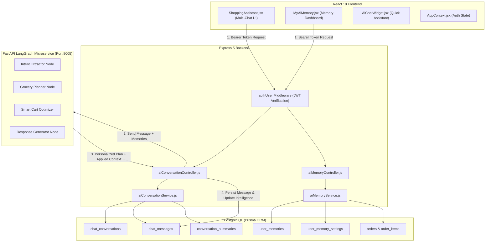

# ShopPilot: Persistent AI Chat History, Resumable Conversations & User-Specific Semantic Long-Term Memory Architecture

## 1. Executive Summary

**ShopPilot** transforms FreshCart from a standard e-commerce store into a personalized, memory-augmented autonomous grocery shopping concierge.

Instead of treating each user prompt as an isolated query, ShopPilot maintains:
1. **Multi-Conversation History in PostgreSQL**: Users can create, search, rename, archive, and delete multiple independent shopping sessions.
2. **Resumable Context**: Conversations can be reopened days or weeks later with full preservation of prior dialogue, grocery plans, and smart cart breakdowns.
3. **User-Specific Semantic Long-Term Memory**: Autonomous preference extraction from both chat dialogue and historical paid orders.
4. **Strict Multi-Tenant Isolation**: Zero data leakage between accounts. Every API call validates user ownership at the database query level.
5. **Full Transparency & User Agency**: Dedicated "My AI Memory" dashboard where customers can inspect, edit, manually add, delete, or disable automated preference extraction.

---

## 2. System Architecture

---

## 3. Database Schema Models

All tables are defined in [`server/prisma/schema.prisma`](file:///d:/FreshCart/server/prisma/schema.prisma) and synced to PostgreSQL:

### 3.1 `ChatConversation`
- **Fields**: `id` (UUID PK), `userId` (FK User), `title`, `status` (`active`, `archived`), `lastMessageAt`, `createdAt`, `updatedAt`.
- **Indexes**: `[userId, status]`, `[userId, lastMessageAt(sort: Desc)]`.
- **Integrity**: Deletion cascades to its `ChatMessage` and `ConversationSummary` records, but leaves user account and orders intact.

### 3.2 `ChatMessage`
- **Fields**: `id` (UUID PK), `conversationId` (FK ChatConversation), `userId` (FK User), `role` (`user`, `assistant`, `system`, `tool`), `content`, `messageType` (`text`, `plan`, `clarification`), `metadata` (JSONB storing `grocery_plan`, `matched_products`, `optimized_cart`, `applied_memories`), `createdAt`, `updatedAt`.
- **Indexes**: `[conversationId, createdAt(sort: Asc)]`, `[userId]`.

### 3.3 `ConversationSummary`
- **Fields**: `id` (UUID PK), `conversationId` (FK ChatConversation), `userId` (FK User), `summary` (Text), `coveredMessageCount`, `version`, `createdAt`, `updatedAt`.
- **Purpose**: Prevents context-window bloat by providing rolling summaries of earlier conversation turns.

### 3.4 `UserMemory`
- **Fields**: `id` (UUID PK), `userId` (FK User), `category` (`household_context`, `budget_preference`, `brand_preference`, `dietary_preference`, `shopping_preference`), `memoryKey`, `memoryValue` (JSONB), `description`, `sourceType` (`conversation`, `order_history`, `user_confirmed`), `sourceId`, `confidence`, `importance`, `status` (`active`, `superseded`, `deleted`), `embedding` (JSONB vector array), `lastUsedAt`, `createdAt`, `updatedAt`.
- **Indexes**: `[userId, status, category]`, `[userId, memoryKey]`.

### 3.5 `UserMemorySetting`
- **Fields**: `id` (UUID PK), `userId` (FK User unique), `autoExtract` (Boolean), `includeInContext` (Boolean), `createdAt`, `updatedAt`.

---

## 4. Preference Conflict Resolution & Order History Mining

### 4.1 Memory Conflict Resolution
When a user updates a preference (e.g. switching preferred brand from "Amul" to "Mother Dairy"):
1. The previous active memory matching `(userId, memoryKey, status = 'active')` is transitioned to `status = 'superseded'`.
2. A new active memory is inserted with the updated value.
3. If identical value is stated again, `confidence` and `lastUsedAt` are reinforced without creating duplicate entries.

### 4.2 Mining Completed Paid Orders
Only orders with `paymentStatus: 'Paid'` are analyzed:
- **Historical Average Spend**: Computes mean `totalAmount` across up to 20 past paid orders to guide target budget suggestions.
- **Top Category Affinity**: Tallies frequencies of categories purchased across order items.
- **Repeat Staple Products**: Identifies products ordered 2 or more times and marks them as regular staples.

---

## 5. Security & Isolation Matrix

| Threat Vector | Mitigation Strategy |
| :--- | :--- |
| **Unauthenticated AI Access** | `authUser` middleware rejects non-Bearer requests with `401 Unauthorized`. Frontend displays Login Gate. |
| **Cross-User Data Leaks** | Every conversation, message, and memory query explicitly filters by `userId: req.user.id`. Direct ID guessing yields `404 / Access Denied`. |
| **Prompt Injection via Memory** | Memories are injected into LangGraph nodes as structured JSON dictionary fields, not raw prompt concatenations. |
| **Data Permanence on Deletion** | Conversation and memory deletion performs verified database removal; soft-deletion is available via `status = 'archived'` or `superseded`. |

---

## 6. Verification Test Suite Results

Automated test suite [`server/test/chatMemoryVerify.js`](file:///d:/FreshCart/server/test/chatMemoryVerify.js) verifies 8 critical capabilities:
- **Test 1**: Multiple independent conversations per user ✅
- **Test 2**: Message persistence, chronological ordering, and JSON metadata ✅
- **Test 3**: Resumable conversation context & versioned summaries ✅
- **Test 4**: Strict cross-user isolation and unauthorized access rejection ✅
- **Test 5**: Semantic memory upsert and categorization ✅
- **Test 6**: Memory conflict resolution and superseding ✅
- **Test 7**: Order history mining from paid orders ✅
- **Test 8**: User memory manual editing, deletion, and cross-user deletion protection ✅

