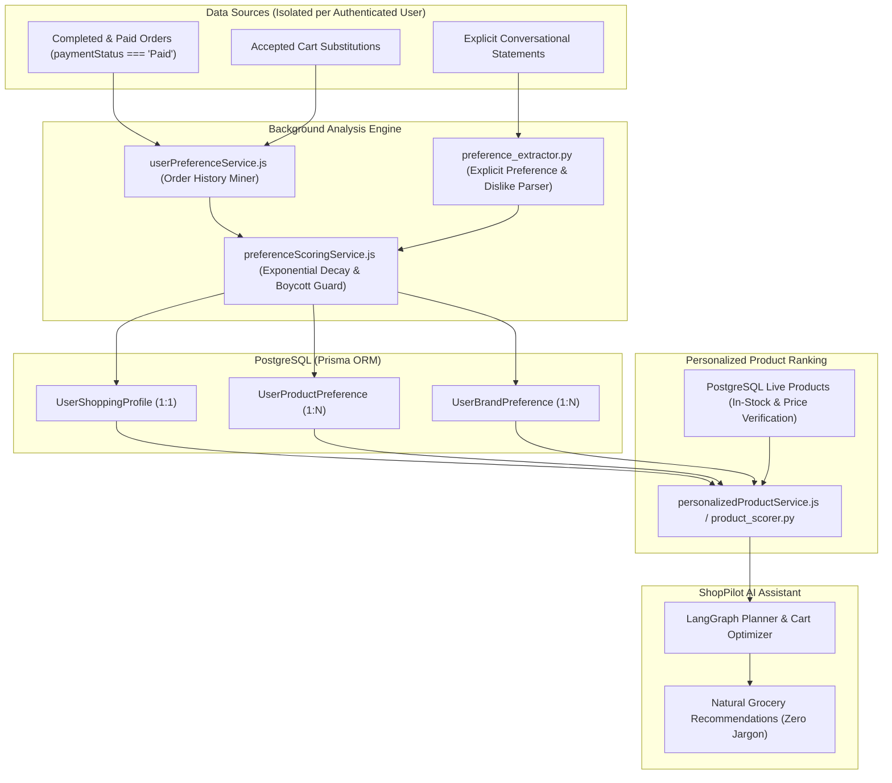

# ShopPilot: Invisible User Preference Learning & Personalized AI Grocery Recommendations Architecture

## 1. Overview & Invisible UX Philosophy

ShopPilot implements an **invisible, background personalization and preference-learning engine**. 

Unlike conventional recommendation interfaces that clutter the screen with memory tags, embedding inspectors, or manual setting cards, ShopPilot's personalization works completely under the hood:
- **No Visible Memory Management UI**: No memory pills, cards, dashboards, or floating badges are exposed to customers.
- **Natural Conversational Delivery**: Recommendations feel intuitive and personal (e.g. *"I've put together your weekly plan, prioritizing Amul milk and fresh staples based on your usual shopping choices"*).
- **Backend-Authoritative Pricing & Stock**: Never recommends out-of-stock items as purchasable; live PostgreSQL catalog `offerPrice` always governs.

---

## 2. End-to-End Personalization Flow

---

## 3. Database Schema Models

Defined in [`server/prisma/schema.prisma`](file:///d:/FreshCart/server/prisma/schema.prisma):

### 3.1 `UserShoppingProfile` (1:1 per User)
- **`userId`**: Unique FK to User.
- **`preferredCategories`**: JSONB array of `{ category: string, frequency: number }`.
- **`preferredBrands`**: JSONB array of `{ brand: string, purchaseCount: number }`.
- **`frequentlyPurchasedProducts`**: JSONB array of regular staple products.
- **`pricePreference`**: `"budget_friendly"` (< ₹1,500 avg spend), `"balanced"`, or `"premium"` (> ₹4,500 avg spend).
- **`typicalBudget`**: Average expenditure across paid orders.
- **`typicalShoppingInterval`**: Average days elapsed between repeat grocery runs.
- **`householdSize`**: Stored only when explicitly provided by the user in conversation.

### 3.2 `UserProductPreference` (1:N per User)
- **Constraints**: `@@unique([userId, productId])`, `@@index([userId, preferenceScore(sort: Desc)])`.
- **Fields**: `purchaseCount`, `totalQuantityPurchased`, `firstPurchasedAt`, `lastPurchasedAt`, `averagePurchaseInterval`, `preferenceScore`, `explicitlyPreferred`, `isDisliked`.

### 3.3 `UserBrandPreference` (1:N per User)
- **Constraints**: `@@unique([userId, brand])`, `@@index([userId, preferenceScore(sort: Desc)])`.
- **Fields**: `brand`, `purchaseCount`, `lastPurchasedAt`, `preferenceScore`, `explicitlyPreferred`, `isDisliked`.

---

## 4. Deterministic Preference Scoring with Recency Decay

Computed in [`server/services/preferenceScoringService.js`](file:///d:/FreshCart/server/services/preferenceScoringService.js):

$$\text{Product Preference Score} = 0.35 \cdot S_{\text{freq}} + 0.30 \cdot S_{\text{recency}} + 0.20 \cdot S_{\text{explicit}} + 0.15 \cdot S_{\text{repeat}}$$

### 4.1 Exponential Time Decay:
$$S_{\text{recency}} = \exp\left(-\frac{\ln(2)}{45} \cdot \Delta t\right)$$
- Purchases made today: $S_{\text{recency}} = 1.0$.
- Purchases made 45 days ago: $S_{\text{recency}} = 0.5$.
- Purchases made 90 days ago: $S_{\text{recency}} = 0.25$.

### 4.2 Negative Preference Override (Boycott Guard):
$$\text{If } \text{isDisliked} = \text{true} \implies \text{Preference Score} = 0.0$$
An explicit recent dislike (e.g., *"I don't like Amul milk anymore"*) immediately overrides years of past purchase volume and collapses the brand's score to zero.

---

## 5. Personalized Product Ranking Formula

Executed in [`server/services/personalizedProductService.js`](file:///d:/FreshCart/server/services/personalizedProductService.js) and [`ai-service/app/discovery/product_scorer.py`](file:///d:/FreshCart/ai-service/app/discovery/product_scorer.py):

$$\text{Final Score} = 0.35 \cdot \text{Relevance} + 0.20 \cdot \text{Availability} + 0.15 \cdot \text{PriceSuitability} + 0.15 \cdot \text{BrandScore} + 0.15 \cdot \text{ProductPreferenceScore}$$

### Strict Invariants:
1. **Out-of-Stock Protection**: If `inStock === false` or `stockQuantity < 1`, $\text{Availability} = 0.0$ and the candidate is never selected as purchasable.
2. **Catalog Price Integrity**: Always uses live PostgreSQL catalog `offerPrice`.
3. **Instruction Precedence**: Immediate user requirements (e.g. *"Plan for 2 people this week"*, *"Suggest a different brand"*) override historical profile parameters.

---

## 6. Background Idempotent Triggers

- **Post-Payment Hook**: When an order is completed and confirmed paid via PayPal capture or webhook (`paymentStatus === "Paid"`), `UserPreferenceService.updatePreferencesFromOrder(order.id)` is fired asynchronously.
- **Post-Turn Chat Hook**: User turns in `aiConversationController.js` trigger `triggerAsyncPreferenceLearning(userId, convId, message)` to capture explicit brand affinities, dislikes, or household changes.
- **Idempotency Guarantee**: All upserts rely on composite primary keys (`[userId, productId]` and `[userId, brand]`), preventing duplicate records or artificial score inflation upon repeated event delivery.

---

## 7. Verification Test Suite Summary

Automated verification suite [`server/test/preferenceLearningVerify.js`](file:///d:/FreshCart/server/test/preferenceLearningVerify.js):
- **Test 1**: Deterministic Preference Scoring with Exponential Decay ✅
- **Test 2**: Order History Mining (Paid Orders vs Ignored Failed Orders) ✅
- **Test 3**: Idempotency of Preference Updates ✅
- **Test 4**: Explicit Conversational Preference Recording ✅
- **Test 5**: Dislike Override on Past Purchases (Score collapses to 0.0) ✅
- **Test 6**: Personalized Product Ranking Engine with negative constraints and stock validation ✅
- **Test 7**: Strict Multi-Tenant User Isolation ✅

